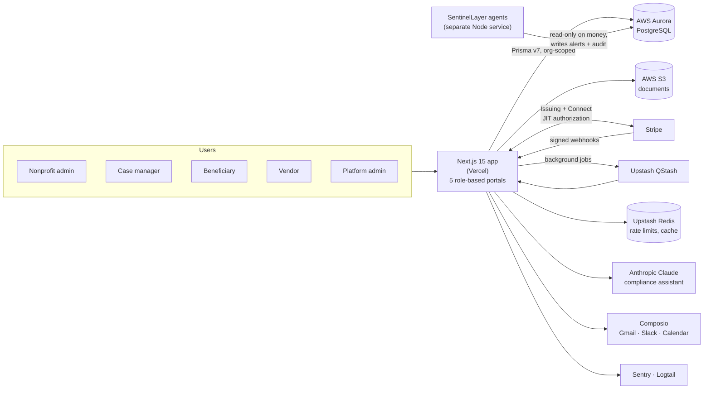

# BenefitsSafe

**Grant disbursement and benefits-compliance platform for nonprofits.**
Live: **[benefitssafe.com](https://benefitssafe.com/)** · Built by [Styner Stiner](https://github.com/StynerStiner)

## The problem

Nonprofits give grant money to people who also rely on public benefits such as SSI, SSDI, Medi-Cal and CalFresh. A well-meant payment can push someone over a program limit, and then they lose the benefits they depend on. Case managers usually track this in spreadsheets, after the money has already gone out.

BenefitsSafe moves that check to before the money is spent. Funds go out on restricted virtual cards. Every expense is classified against the benefit rules, and staff are alerted before a person gets close to a limit.

## What it does

- **Five role-based portals in one app:** platform admin, nonprofit admin, case manager/staff, beneficiary and vendor.
- **Grants and budgets:** grant setup, budget categories, disbursement policies and approval chains.
- **Restricted virtual cards:** Stripe Issuing cards with merchant-category (MCC) spending controls. Real-time (JIT) authorization approves or declines each purchase against the grant's rules.
- **Benefits-compliance engine** (`utils/compliance-rules/`): federal SSI rules and California Medi-Cal, CalFresh and IHSS rules. Expenses are sorted into four tiers: `LIKELY_SAFE`, `NEEDS_REVIEW`, `LIKELY_RISKY` and `BLOCKED`.
- **Immutable ledger and audit trail:** `LedgerEntry` and `AuditLog` rows are never updated or deleted.
- **AI compliance assistant:** a Claude-powered chat helper for staff questions about benefit rules.
- **Grant reporting:** disbursement summaries, spending by category, burn-rate projections and PDF/CSV export.
- **Workflow integrations:** Gmail, Slack, Google Calendar, Sheets, Asana and Trello through Composio. These calls are fire-and-forget, so a failed integration never blocks the core flow.
- **Team features:** messaging, calendar, document uploads (S3) and notifications.
- **Autonomous agents:** run in a separate service, [SentinelLayer](https://github.com/StynerStiner/sentinellayer). Its watchdog tracks how close each person is to SSI, SSDI (SGA), Medi-Cal and CalFresh limits, and its compliance monitor flags unusual spending.

## Architecture



**Key design decisions**

| Decision | Why |
|---|---|
| Modular monolith | One Next.js app serves all five portals, which keeps deploys and auth in one place |
| Every query scoped by `organizationId` | Stops data leaking across nonprofits. A security test checks the Prisma org-scoping |
| Immutable ledger | Money movement can always be reconstructed for auditors and funders |
| Webhooks acknowledge fast, heavy work goes to a queue | Stripe gets a quick response, and classification and ledger writes run in QStash jobs |
| Agents run as a separate process | SentinelLayer can only write notifications and audit rows, never financial data |

## Security and compliance

- **Auth:** NextAuth v5 (credentials and Google), JWT sessions carrying role and organization claims.
- **MFA:** TOTP, with encrypted secrets and hashed backup codes.
- **Encryption:** AES-256-GCM for sensitive fields, and TLS to the database.
- **Validation:** Zod on API boundaries, plus per-endpoint rate limiting.
- **Stripe webhooks:** signature verification on every event.
- **AWS:** Secrets Manager, CloudTrail and Security Hub.
- **Privacy:** CCPA/CPRA privacy policy and terms.
- **Custom lint rules:** auth-guard, DB-health and stale-cache conventions run in CI, and there's a credential-freshness check too.
- **Operations docs** in [`docs/`](docs/): incident response, disaster recovery, rollback, credential rotation, failover and game-day runbooks, plus performance SLA targets.

## Tech stack

| Layer | Tools |
|---|---|
| Frontend | Next.js 15 (App Router), React 19, TypeScript, Tailwind CSS, shadcn/ui, ApexCharts, FullCalendar |
| Backend | Next.js API routes and server actions, Prisma v7 (PrismaPg adapter), Zod |
| Data | AWS Aurora PostgreSQL, AWS S3, Upstash Redis and QStash |
| Payments | Stripe Issuing, Stripe Connect |
| AI and automation | Anthropic Claude SDK, Composio, SentinelLayer agents |
| Observability | Sentry, Logtail |
| Testing | Vitest (unit, API, compliance and security tests), Playwright (end-to-end flows), k6 (load-test scripts) |
| CI/CD | GitHub Actions (type check, tests, lint conventions), Vercel, canary-to-stable promotion workflow |

## Run it locally

```bash
git clone https://github.com/StynerStiner/benefitssafe-app.git
cd benefitssafe-app
cp .env.example .env.local   # fill in your own database, Stripe test and auth values
npm install                  # also runs prisma generate
npx prisma migrate deploy
npm run dev
```

Tests:

```bash
npm test            # Vitest
npm run test:e2e    # Playwright
```

> This repo holds no real keys. `.env.example` has placeholders only.

## Project layout

```
app/            Next.js routes: (dashboard) portals, api/ routes, auth, legal pages
components/     UI components
lib/            Encryption, Stripe, Prisma, services and helpers
utils/          Benefits-compliance rules (federal SSI, California)
prisma/         Database schema and migrations
__tests__/      Vitest suites
e2e/            Playwright flows
docs/           Architecture, security, operations and runbooks
scripts/        Lint conventions and load tests
```

---

Part of my [portfolio](https://github.com/StynerStiner/StynerDev-Portfolio) · Building & Automation
