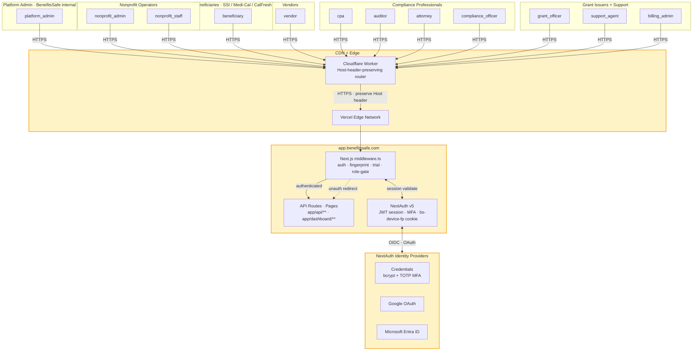

# CTM-BASELINE.md — BenefitsSafe Continuous Threat Modeling Baseline

**Status:** Canonical baseline threat model. Every PDR's Failure Modes section references this document.

**Initial baseline:** 2026-04-23.

**Curator:** Styner Stiner (solo founder). On hiring engineering leadership, transfer this role explicitly in the Change Log below.

**Reference:** Tarandach & Coles, *Threat Modeling* (O'Reilly 2020), Chapter 5 — The Autodesk Continuous Threat Modeling Methodology (A-CTM), and Chapter 3 (STRIDE-per-Element, LINDDUN).

---

## §0 How to use this document

Every PDR that makes a code, schema, config, or infrastructure change to `benefits-safe-app` walks this contract:

1. **Grep §3 Crown Jewels for scope match.** If the PDR's touched files, DB tables, external integrations, or routes overlap any entry in §3, the PDR's **Documented Failure Modes** section must reference the Crown Jewels entry by name (e.g. `CJ-8`) and explain how the change affects that asset's confidentiality / integrity / availability.

2. **Walk §4 Trust Boundaries.** If the PDR crosses any boundary listed in §4 (user ↔ app, app ↔ Stripe, app ↔ Aurora, org A ↔ org B, platform admin ↔ tenant data, etc.), reference the boundary entry by ID (e.g. `TB-6`) and explain what verification ensures the crossing is intended.

3. **Append to §2 DFD + §3 Crown Jewels + §4 Trust Boundaries on new architecture.** If the PDR introduces a new external service, new database, new role, new trust boundary, or a new asset worth calling a crown jewel, update this document **in the same merge commit**. "We'll update the doc later" is the anti-pattern this rule prevents.

4. **Add to §6 Open Questions on discovered gaps.** If the PDR surfaces a question this document doesn't answer ("does cascade-delete cover X?", "is route Y scoped the way we think?"), add an entry to §6 in the same merge. Future PDRs pick them up. This is A-CTM's `potential-tm-update` pattern — unknowns get logged as tickets, never left as silent assumptions.

5. **Record remediation in [/DEPENDENCY_AUDIT.md](../DEPENDENCY_AUDIT.md).** When a PDR fixes a vuln or misconfig against a Crown Jewel or boundary, append a row per its column schema.

The same contract lives in [/CLAUDE.md → Threat Model Every Story (CTM)](../CLAUDE.md) — intentional redundancy so a PDR author who opens either document cold gets the rules. Update both when the contract itself changes.

---

## §1 System purpose and scope

BenefitsSafe is a production fintech platform for the ~1.9M US nonprofits that disburse restricted grant funds to vendors on behalf of beneficiaries receiving SSI, SSDI, Medicaid, Medi-Cal, and CalFresh — without jeopardizing those beneficiaries' government benefits. The platform handles PII (including DOB, address, `ssnLast4`, benefit-program flags), real money (via Stripe Connect + Issuing + Treasury + Billing), and authenticated multi-tenant sessions across 12 user roles and 7+ external service integrations. A single compliance failure can cost a beneficiary their SSI/Medi-Cal eligibility; a single data breach can expose disability status; a single cross-org leak destroys the many-tenants-per-platform trust model. The threat-modeling rigor in this document is proportional to those consequences.

---

## §2 Level-0 Data Flow Diagram

The DFD is split into two views to stay readable. Both render natively in GitHub's markdown viewer.

### §2.1 User-facing view — roles, auth, primary app boundary

### §2.2 Inner view — webhooks, data, async, observability, third-party integrations

```mermaid
flowchart TB
    subgraph AppCore["BenefitsSafe App Core"]
        API[API Routes<br/>app/api/**]
        Guards[Auth Guards<br/>lib/auth-guard.ts<br/>+ org-context AsyncLocalStorage]
        Circuit[Stripe Circuit Breaker<br/>lib/stripe-circuit.ts<br/>closed · open · half-open]
        Idem[Webhook Idempotency<br/>lib/webhook-idempotency.ts<br/>+ ProcessedWebhookEvent]
        Compliance[Compliance Engine<br/>utils/compliance-rules/<br/>federal-ssi + california]
    end

    subgraph StripeServices["Stripe · outbound"]
        SC[Stripe Connect<br/>account onboarding]
        SI[Stripe Issuing<br/>virtual cards · authorizations]
        ST[Stripe Treasury<br/>financial accounts]
        SB[Stripe Billing<br/>platform subscriptions]
    end

    subgraph StripeWebhooks["Stripe · inbound webhooks"]
        WStripe["/api/webhooks/stripe<br/>Connect + Issuing account events"]
        WBilling["/api/webhooks/stripe-billing<br/>checkout + subscription events"]
        WCharges["/api/webhooks/stripe-charges<br/>Issuing auth + transactions"]
        WFraud["/api/webhooks/stripe/fraud<br/>dispute + fraud signals"]
    end

    subgraph DataStores["Persistent Data"]
        Aurora[(Aurora PostgreSQL<br/>us-east-2<br/>Prisma + $extends shadow mode<br/>organizationId scoped)]
    end

    subgraph Async["Async · Scheduled"]
        QS[Upstash QStash<br/>job queue · signed payloads]
        CRON[Vercel Cron<br/>bearer-token auth]
    end

    subgraph Observability["Observability · PII-scrubbed"]
        BS[Better Stack<br/>structured logs · correlationId]
        SEN[Sentry<br/>error tracking]
    end

    subgraph Integrations["Third-Party Integrations"]
        PL[Plaid<br/>bank link verification]
        CMP[Composio<br/>workflow automation]
        AN[Anthropic Claude<br/>Compliance Assistant]
    end

    API --> Guards
    API --> Circuit
    Circuit -->|signed HTTPS| SC
    Circuit -->|signed HTTPS| SI
    Circuit -->|signed HTTPS| ST
    Circuit -->|signed HTTPS| SB

    SC -->|signature-verified| WStripe
    SI -->|signature-verified| WStripe
    SI -->|signature-verified| WCharges
    SI -->|signature-verified| WFraud
    SB -->|signature-verified| WBilling

    WStripe --> Idem
    WBilling --> Idem
    WCharges --> Idem
    WFraud --> Idem
    Idem --> API

    API -->|TLS · scoped<br/>$transaction · Serializable| Aurora
    API -->|enqueue · signed| QS
    QS --> CRON
    CRON -->|bearer token| API

    API -->|scrubbed| BS
    API -->|scrubbed| SEN

    API -->|link init| PL
    API -->|invoke| CMP
    API -->|chat inference| AN

    Compliance -.-> API
    Guards -.-> API

    classDef boundary fill:#fef3c7,stroke:#f59e0b,stroke-width:2px
    class StripeServices,StripeWebhooks,DataStores,Async,Observability,Integrations boundary
```

---

## §3 Crown Jewels Inventory

The list a future PDR greps against. Every row names the asset, where it lives, what breaks if the CIA triad (Confidentiality / Integrity / Availability) is violated, and the regulation(s) that apply.

| # | Asset | Location | Break-consequence | Regulations |
|---|-------|----------|-------------------|-------------|
| **CJ-1** | **Beneficiary PII** — `firstName`, `lastName`, `dateOfBirth`, `addressStreet`/`City`/`State`/`Zip`, `ssnLast4`, `benefitPrograms`, `emergencyContact*` | `User` model ([prisma/schema.prisma](../prisma/schema.prisma)); routes: `/api/beneficiaries/**`, `/api/user/**` | **C:** cross-tenant disclosure enables SSI/Medi-Cal eligibility targeting. **I:** tamper changes benefit-program flags → wrong compliance classification → lost benefits. **A:** non-critical. | CCPA §1798.100–1798.150 (right-to-know, -delete, -opt-out), GDPR Arts. 5/6/17/32, HIPAA-adjacent (SSI/Medi-Cal eligibility is health-coverage-linked) |
| **CJ-2** | **`ssnLast4` encryption boundary** | `User.ssnLast4` — app-level encrypted, NEVER returned in list endpoints, NEVER in AuditLog diffs | **C:** disclosure exposes last-4 nationally identifiable when combined with DOB + ZIP (Sweeney 2000 triad). | CCPA §1798.81.5 (reasonable security), GDPR Art. 32 |
| **CJ-3** | **Grant fund balances + LedgerEntry integrity** | `Grant.totalAmount`/`spentAmount`/`remainingAmount` (Decimal 12,2 + CHECK constraints); `LedgerEntry` (IMMUTABLE, append-only) | **I:** tamper with `LedgerEntry` breaks legal audit trail + SOX-style financial evidence. **I:** tamper with `Grant.*Amount` enables overspend beyond restricted funds. | IRS restricted-fund rules, state nonprofit accounting (Cal. Corp. Code §5212), SOC 2 CC7.2 |
| **CJ-4** | **Stripe Connect + Issuing card data** | `Organization.stripeAccountId`, `Organization.stripeFinancialAccountId`, `VirtualCard.stripeCardId`, `Transaction.stripeTransactionId` | **C:** stripeAccountId disclosure does not expose balances (Stripe scopes access), but enables targeted phishing. **I:** tamper with `VirtualCard` state creates authorization-vs-ledger divergence. **A:** circuit-breaker-guarded; Stripe outage degrades gracefully. | PCI DSS (Stripe SAQ-A; PANs never touch our DB), Stripe platform ToS |
| **CJ-5** | **Webhook secrets + signature verification** | Vercel env: `STRIPE_WEBHOOK_SECRET`, `STRIPE_WEBHOOK_SECRET_BILLING`, `STRIPE_WEBHOOK_SECRET_CHARGES`, `STRIPE_WEBHOOK_SECRET_FRAUD` | **C:** disclosure enables forged webhooks → fraudulent `Transaction`/`Grant` mutations. | PCI DSS (secret management), Stripe webhook signing docs |
| **CJ-6** | **Session + auth secrets** | `AUTH_SECRET` / `NEXTAUTH_SECRET`, JWT session tokens, `User.passwordHash` (bcrypt), `User.mfaSecret` (encrypted TOTP), `User.mfaBackupCodes` (hashed) | **C:** `AUTH_SECRET` disclosure enables JWT forgery → full account takeover for all users. **C:** `mfaSecret` disclosure defeats MFA. | CCPA §1798.81.5, GDPR Art. 32, NIST 800-63B |
| **CJ-7** | **`AuditLog` integrity (append-only)** | `AuditLog` model (IMMUTABLE — never UPDATE, never DELETE); write path: every state-changing route | **I:** tamper destroys legal evidence + SOX audit chain + the weekly review's ability to catch anomalies. **C:** reads scoped to `platform_admin` + org-scoped `nonprofit_admin` only. | SOC 2 CC7.3 + CC7.4 (audit logging), IRS §501(c)(3) records retention, Cal. Corp. Code audit-inspection rights |
| **CJ-8** | **`organizationId` scoping invariant** | Every org-scoped Prisma query (409 SCOPED + 90 HANDLER_HAS_ORG + 25 BY_ID_WITH_HANDLER_ORG = 524/742 queries per [docs/audits/README.md](audits/README.md)); `lib/org-context.ts` AsyncLocalStorage; Prisma `$extends` shadow-mode middleware | **I:** failure = cross-org data leak = every tenant sees every other tenant's beneficiaries/grants/ledger. Worst possible multi-tenant failure. | CCPA §1798.150 (reasonable security → data-breach class action), GDPR Art. 32, SOC 2 CC6.1 |
| **CJ-9** | **Platform-admin cross-org exemption** | `withOrgContext({ kind: "exempt", reason: "PLATFORM_ADMIN" })` wrap; routes under `/api/platform/**` and `/api/admin/**` | **C:** unintended exempt-wrap on a tenant-facing route enables unauthorized cross-org reads. **I:** operator-initiated cross-org writes bypass tenant isolation. | SOC 2 CC6.3 (privileged access), CCPA §1798.81.5 |
| **CJ-10** | **Fund transfer idempotency chain** | `FundTransfer` model, `/api/org/fund`, `/api/org/fund/[transferId]/status`; ACH rail via Stripe Treasury | **I:** missing idempotency = double-debit on retry = real money lost. DDIA Ch 12 audit verified closed (P1 circuit + webhook idempotency + unique indexes). | Reg E (consumer ACH protections), NACHA rules |
| **CJ-11** | **Aurora master credential + connection string** | `DATABASE_URL` env var (Vercel), rotation runbook: [docs/runbooks/aurora-credential-rotation.md](runbooks/aurora-credential-rotation.md) | **C:** disclosure = direct DB access = total data exposure + integrity violation. | CCPA §1798.81.5, GDPR Art. 32, SOC 2 CC6.1 |
| **CJ-12** | **Third-party API keys** | `ANTHROPIC_API_KEY` (Claude), Plaid item tokens (`Organization.plaidItemId`), Composio credentials (`Integration` model) | **C:** key disclosure = impersonation + cost impact (Claude). **C:** Plaid item disclosure = bank-data read access. | Provider ToS, CCPA §1798.81.5 |

---

## §4 Trust Boundaries

Each row: what crosses the boundary, what the guarantees change on the far side, and what code enforces the crossing rules.

| # | Boundary | What crosses | What changes | Enforcement |
|---|----------|--------------|--------------|-------------|
| **TB-1** | **User ↔ app.benefitssafe.com** | Browser requests, session cookies (`authjs.session-token` / `__Secure-authjs.session-token`), `bs-device-fp` fingerprint cookie | Anonymous → authenticated (after auth flow); CSRF-unsafe → CSRF-protected (NextAuth double-submit) | `middleware.ts` `isPublicPath()` allowlist; `lib/auth-guard.ts` `requireAuth/requireAdmin/requirePlatformAdmin` |
| **TB-2** | **App ↔ Stripe (outbound)** | Stripe API calls (`stripe.accountLinks.create`, `stripe.issuing.*`, etc.) | Our secret (`STRIPE_SECRET_KEY`) → their auth; our rate limits → Stripe rate limits; timeouts racing our circuit | `lib/stripe-circuit.ts` wraps every outbound call; 5 required + 15 adopter routes verified in DDIA P1 |
| **TB-3** | **Stripe ↔ App (inbound webhooks)** | `POST /api/webhooks/stripe/**` from Stripe's IPs | Untrusted body → signature-verified → idempotency-dedup → trusted event | Ed25519 signature check per endpoint (separate secret per endpoint); `lib/webhook-idempotency.ts` `markWebhookProcessed`/`releaseWebhookEvent`; `ProcessedWebhookEvent` unique index |
| **TB-4** | **App ↔ Aurora** | Prisma queries with `organizationId` predicate (or explicitly exempt wrap) | App identity (deploy credential) → DB row-level tenancy via `organizationId`; nontransactional → `$transaction` on money writes | Prisma `$extends` shadow-mode middleware + ALS `OrgContext`; 409 SCOPED + 25 BY_ID + 90 HANDLER_HAS_ORG queries verified safe (2026-04-17 audit) |
| **TB-5** | **App ↔ QStash / Vercel Cron** | Job payloads (outbound enqueue) and bearer-token-authed callbacks (inbound) | App identity → signed/shared-secret job identity; untimed → scheduled | `verifyJobAuth()` on `/api/jobs/**`; bearer-token check on `/api/cron/**`; signed QStash payloads |
| **TB-6** | **Org A ↔ Org B** (the critical one) | Any query touching a different `organizationId` than `session.user.organizationId` | Zero legitimate direct crossings for non-platform roles. Every attempted cross is either (a) forbidden and rejected, (b) derived-via-Stripe-ID webhook pattern, or (c) `platform_admin` exempt-wrap | Prisma shadow-mode extension logs `[org_scoping_shadow]` events on every query; 742-query manual audit verified zero true cross-org leaks |
| **TB-7** | **Platform admin ↔ tenant data** | Platform-only routes under `/api/platform/**`, `/api/admin/**` | Tenant-scoped → cross-org read/write with operator `userId` in AuditLog | `requirePlatformAdmin(ctx, ...)` guard; explicit `withOrgContext({ kind: "exempt", reason: "PLATFORM_ADMIN" })` wrap; AuditLog entry with operator identity + zod-validated `reason` for breakglass writes (e.g., `reset-negative-balance-flag`, min 10 chars) |
| **TB-8** | **App ↔ Observability (Better Stack + Sentry)** | Structured log events, error payloads | In-process PII → PII-scrubbed log event | `lib/error-response.ts` injects `correlationId` + structured `[api_error]` events; BetterStack source config scrubs known PII field names (ongoing — see §6 Open Questions) |
| **TB-9** | **App ↔ Third-party integrations (Plaid, Composio, Anthropic)** | Per-integration auth (Plaid Link tokens, Composio API, Anthropic API key) | App identity → provider-scoped identity | Per-provider env var isolation; outbound rate/error handling per integration |

---

## §5 Baseline Findings (already mitigated as of 2026-04-23)

Baseline = what the codebase has already done. A PDR's Failure Modes section shouldn't re-find these — only flag regressions or new-shape attacks.

### §5.1 Dependency + supply-chain hardening

- **T2** (`e8802db`, 2026-04-22) — `fast-xml-parser >=5.7.0` override closes GHSA in AWS SDK transitive chain.
- **T3** (`52836c8`, 2026-04-22) — `d3-color >=3.1.0` override closes GHSA-36jr-mh4h-2g58 ReDoS in `react-simple-maps` chain on 7 WorldMapChart dashboard pages.
- **T4** (`3e58336`, 2026-04-23) — self-hosted `countries-110m.json` in `/public`, CSP `connect-src` preserved (no widening to `cdn.jsdelivr.net`).
- **`.npmrc` baseline** — `ignore-scripts=true`, `save-exact=true`, `legacy-peer-deps=true`; `package-lock.json` committed; `engines.node` pinned.
- **Accepted exceptions** — see [docs/security-exceptions.md](security-exceptions.md): Prisma 7 dev-server chain (4 moderate, dev-only, localhost-bound), NextAuth v5 beta (0 vulns, version risk), Stripe SDK 14.x (0 vulns, 3 majors behind), `uuid` advisory (not triggered — only `v4()` used).

### §5.2 DDIA Chapter 12 tail (all CLOSED per [docs/STATUS-DDIA-AUDIT.md](STATUS-DDIA-AUDIT.md))

| Defect | Mechanism | Evidence |
|--------|-----------|----------|
| **C2** — billing duplicate checkout | `hasActiveSubscription` guard + `handleUpgrade` short-circuit | `app/(dashboard)/settings/billing/page.tsx:103-122` |
| **H1** — Stripe Connect callback URL | `stripe_connect_success` param matches consumer | `app/api/org/stripe-onboarding/route.ts:243-257` |
| **H2** — `account.updated` webhook handler | `bankConnectedAt` + `lastStripeAccountEventAt` (event-time ordering guard); full state in AuditLog | `app/api/webhooks/stripe/route.ts:124-125, 689-767` |
| **H4** — declined authorization logging | `issuing_authorization.created` + `approved === false` → Transaction(declined) + AuditLog + admin Notification | `app/api/webhooks/stripe-charges/route.ts:54-123` |
| **H5** — duplicate Transaction risk | 4-layer defense: route scoping + opt-out comment + app-level idempotency + DB unique index on `stripeTransactionId` | `app/api/webhooks/stripe/route.ts:122-123` + `stripe-charges/route.ts:176-182` |
| **P1** — Stripe circuit breaker | `lib/stripe-circuit.ts` (254 LOC) wrapped at 5 required + 15 adopter routes; per-process state machine | `lib/stripe-circuit.ts` |

### §5.3 Multi-tenant isolation (CJ-8 + TB-4 + TB-6)

- **Cross-org isolation audit** (2026-04-17, [docs/audits/README.md](audits/README.md)) — 742 queries classified, 0 true cross-org leaks found. Breakdown: 409 SCOPED · 110 EXEMPT_SCRIPT · 90 HANDLER_HAS_ORG (all adversarially verified safe) · 33 NON_ORG_MODEL · 25 BY_ID_WITH_HANDLER_ORG · 24 EXEMPT_CRON · 23 WEBHOOK_REVIEW (all verified) · 11 EXEMPT_PLATFORM · 10 AUTH_FLOW · 7 TRUE_UNSCOPED (all cleared).
- **Prisma middleware Phase 1** (shadow mode, `9428032`) — `$extends` + ALS-backed `OrgContext` log-classifies every org-scoped-model query. 4 representative handlers wrapped; double try/catch guarantees a bug in the extension cannot break real traffic.
- **Webhook idempotency** (`1fb4df5`, 2026-04-17) — 4/4 handlers (`stripe`, `stripe-billing`, `stripe-charges`, `stripe-fraud`) wired via `lib/webhook-idempotency.ts`. Fraud handler was the last gap.

### §5.4 DDIA Chapter 7 (Transactions) — all P1–P5 CLOSED (see [docs/design-notes/ddia-ch07-transactions-applied.md](design-notes/ddia-ch07-transactions-applied.md))

- **P1** — `retryOnSerializationFailure` wrapping on `virtual-cards/[id]/close` + `jobs/process-charge` Serializable tx sites (`70808ee`).
- **P2** — `handleDisputeCreated` wrapped in `prisma.$transaction` (`dea1876`).
- **P3** — invite-token redemption uses `updateMany` + `usedAt: null` compare-and-set guard (`dab2f0f`).
- **P4** — `Grant` CHECK constraints with `allowNegativeBalance` escape hatch + auto-reset on admin-refill (`07c6611` + `854a984`).
- **P5** — `VirtualCard uniq_active_card_per_grant_beneficiary` partial unique index (`07c6611`).
- **AuditLog NOT NULL fix** on 4 webhook sites (`54926d8`) — latent runtime bug hidden by `@ts-nocheck` that would have caused permanent dispute/fraud event loss on first real Stripe traffic.

### §5.5 Auth + authorization rigor (TB-1, TB-7)

- **Auth-guard convention linter** — [scripts/lint/auth-guard-convention.mjs](../scripts/lint/auth-guard-convention.mjs) enforces: Rule A (guard import required if `@/auth` imported), Rule B (no direct `session.user.role`), Rule C (no bare `NextResponse.json({ error })`). CI-blocking. Grandfather allowlists (74/12/63 at 2026-04-18 baseline) are one-way-ratchet — shrink only.
- **Session fingerprinting** — `middleware.ts` hashes `ip + userAgent` via Web Crypto; stores 30d cookie; flags mismatch on sensitive routes via `x-session-suspicious` header.
- **BSRS Ch 5 §5.3 reason-gating** ([docs/security/access-classification.md](security/access-classification.md)) — zod-validated `reason` (min 10 chars) required on: `Grant → ARCHIVED|COMPLETED`, `Vendor → BLOCKED`, platform breakglass `reset-negative-balance-flag`.
- **BSRS Ch 5 P4.1 correlation IDs** + **P4.2 shared role-guard helpers** shipped (see [docs/design-notes/bsrs-ch05-least-privilege-applied.md](design-notes/bsrs-ch05-least-privilege-applied.md)).

### §5.6 Headers + CSP posture (TB-1)

- **CSP** (`next.config.ts:35-36`) — `default-src 'self'`; `connect-src` limited to Stripe + Upstash + Sentry + Better Stack; `frame-ancestors 'none'`; `img-src 'self' data: https: blob:`. Unchanged byte-for-byte `e8802db → HEAD` (verified during T4).
- **Cloudflare Worker** (`7e02e9d`) — preserves original `Host` header end-to-end so NextAuth cookie domain matches on `.benefitssafe.com`.
- **Session cookie scoping** (`352be6c6`) — `.benefitssafe.com` domain scope + correct `AUTH_URL`. Known side effect: localhost + Vercel preview cannot complete authenticated flows (FM-2 — transfers runtime validation to production).

### §5.7 Operational posture

- **Incident response** — [docs/incident-response-plan.md](incident-response-plan.md).
- **Rollback** — [docs/rollback-procedure.md](rollback-procedure.md).
- **Disaster recovery** — [docs/disaster-recovery.md](disaster-recovery.md).
- **Credential rotation** — [docs/runbooks/credential-rotation.md](runbooks/credential-rotation.md), [aurora-credential-rotation.md](runbooks/aurora-credential-rotation.md).
- **Failure-domain failover** — [docs/runbooks/failure-domain-failover.md](runbooks/failure-domain-failover.md).
- **Quarterly game day** — [docs/runbooks/quarterly-game-day.md](runbooks/quarterly-game-day.md).
- **Weekly audit-log review** — [docs/runbooks/audit-log-review.md](runbooks/audit-log-review.md).
- **Canary alert rules** — [docs/runbooks/canary-alert-rules.md](runbooks/canary-alert-rules.md).

---

## §6 Open Questions / Known Unknowns

These are A-CTM `potential-tm-update` tickets — tracked here so they don't become silent assumptions. Each is a candidate for a future PDR.

| # | Question | Discovered | Home |
|---|----------|------------|------|
| **OQ-1** | `middleware.ts:229` matcher regex attempts to exclude `public/` but Next serves `/public/*` at URL root, so exclusion never matches. Every static-asset fetch (including T4's `/maps/countries-110m.json` on 7 pages) transits the full middleware stack. Fix is ~1 character. | T4 V-4 diagnosis (2026-04-23) | Tracked as **T5** (see memory `project_t5_candidate_middleware_matcher.md`) |
| **OQ-2** | Prisma middleware Phase 2/2b/3 enablement — awaiting ≥48h of Phase 1 shadow telemetry before flipping enforcement switches. | 2026-04-17 cross-org audit | [docs/runbooks/prisma-middleware-phase-2-3-enablement.md](runbooks/prisma-middleware-phase-2-3-enablement.md) |
| **OQ-3** | Auth-guard linter allowlists (74/12/63 at 2026-04-18) need continued shrinking. Every legacy migration removes one entry; goal is zero. | BSRS Ch 5 P4.2 | [docs/runbooks/auth-guard-convention.md](runbooks/auth-guard-convention.md) |
| **OQ-4** | Stripe SDK 14.x → 17.x upgrade sprint (3 majors behind). No current vulns; API features deferred. | [docs/security-exceptions.md](security-exceptions.md) | Needs a dedicated upgrade PDR |
| **OQ-5** | NextAuth v5 beta → stable migration within 30 days of stable release announcement. | [docs/security-exceptions.md](security-exceptions.md) | Monitor NextAuth releases |
| **OQ-6** | BSRS Ch 5 P2b — beneficiary `isActive=false` reason-gating deferred (UI modal work). | [access-classification.md](security/access-classification.md) | BSRS Ch 5 stream |
| **OQ-7** | BSRS Ch 8 Tier 1/2/3 + linter + doc close still open. P3/P5 open. | Memory: `project_bsrs_ch08_stream.md` | BSRS Ch 8 stream |
| **OQ-8** | BSRS Ch 5 P1 diagnostic — halted at Checkpoint A. | Memory: `project_bsrs_ch05_stream.md` | BSRS Ch 5 stream |
| **OQ-9** | DDIA Ch 12 Phase 2B deferred catalog — post-launch refinements. | Memory: `project_ch12_audit.md` | Post-launch stream |
| **OQ-10** | BetterStack + Sentry PII-scrubbing posture needs field-name audit under real traffic. Code-level scrub is in place; operational scrub-coverage untested. | This baseline | Deferred to LINDDUN-ops PDR (post-customer) |
| **OQ-11** | Stripe Treasury final approval pending — non-blocking for non-Treasury flows. | Memory: `project_security_remaining.md` | Gated on Stripe review |
| **OQ-12** | LINDDUN-code audit scope covers D/N/D/N letters; L/I/U deferred to LINDDUN-ops (requires real traffic + log volume + analytics + policy-vs-collection audit). | This baseline | Scheduled as **Prompt B** (next PDR after this baseline merges) |
| **OQ-13** | STRIDE-per-Element audit of the production attack surface — deferred until customer data exists to produce actionable (not theoretical) findings. | This baseline | Deferred (see memory `feedback_pdr_combined_pass.md` + conversation) |
| **OQ-14** | DB model-count drift: [docs/schema.md](schema.md) reports 25 models (auto-generated 2026-04-08), [access-classification.md](security/access-classification.md) reports 33 (2026-04-18). Some combination of additions and counting convention. Reconcile on next schema touch. | Detected while writing this baseline | Minor — next schema-touching PDR |
| **OQ-15** | LINDDUN-D: `/api/user/data-export` does not include `Message` / `ConversationParticipant` rows. Exporting requires a policy decision — user's own sent messages only, or all messages in conversations they participate in (which would expose other participants' PII)? GDPR Art. 15 "specific pieces of personal information" is ambiguous on shared-context data. | LINDDUN-CODE audit 2026-04-23 | [docs/security-audits/LINDDUN-CODE-2026-04-23.md §1](security-audits/LINDDUN-CODE-2026-04-23.md) |
| **OQ-16** | LINDDUN-D: `/api/user/data-export` caps `AuditLog` rows at 100. GDPR Art. 15 expects the full history; CCPA §1798.130(a)(3)(B) allows a 12-month window. Needs pagination or windowed-delivery design plus a performance plan (user could have 10M+ audit rows at scale). | LINDDUN-CODE audit 2026-04-23 | [docs/security-audits/LINDDUN-CODE-2026-04-23.md §1](security-audits/LINDDUN-CODE-2026-04-23.md) |
| **OQ-17** | LINDDUN-D: `/api/user/data-export` does not include `Transaction` rows. Reachable transitively via `VirtualCard.beneficiaryId`; needs a JOIN (20+ lines) and a field-selection policy (merchant category, amount, status — yes; raw Stripe metadata — no). | LINDDUN-CODE audit 2026-04-23 | [docs/security-audits/LINDDUN-CODE-2026-04-23.md §1](security-audits/LINDDUN-CODE-2026-04-23.md) |
| **OQ-18** | LINDDUN-N: `/api/user/data-deletion` (self-service) does NOT scrub `AuditLog.oldValue` / `newValue` JSON the way `/api/admin/data-deletion` does. Beneficiary-initiated deletions leave PII sitting in audit JSON blobs indefinitely. Fix requires extracting a shared helper into `lib/data-deletion.ts` and calling it from both routes — in-place duplication would be ~50 lines across two files and a PII-keys drift hazard. | LINDDUN-CODE audit 2026-04-23 | [docs/security-audits/LINDDUN-CODE-2026-04-23.md §2](security-audits/LINDDUN-CODE-2026-04-23.md) |
| **OQ-19** | LINDDUN-N: `Message.content` and `Conversation.title` are not anonymized on user deletion. Policy decision required: anonymize the user's messages to `"[deleted]"` vs soft-delete them vs leave intact (other participants' legitimate record of the conversation). Affects `CJ-1` (Beneficiary PII). | LINDDUN-CODE audit 2026-04-23 | [docs/security-audits/LINDDUN-CODE-2026-04-23.md §2](security-audits/LINDDUN-CODE-2026-04-23.md) |
| **OQ-20** | LINDDUN-N: no verification step on self-service `/api/user/data-deletion`. Current flow = one authenticated POST → immediate irreversible anonymization. CCPA §1798.130(a)(2) requires verification methods; GDPR Art. 12(6) allows additional identity confirmation. Needs email-confirmation token + cooling-off UI. | LINDDUN-CODE audit 2026-04-23 | [docs/security-audits/LINDDUN-CODE-2026-04-23.md §2](security-audits/LINDDUN-CODE-2026-04-23.md) |
| **OQ-21** | LINDDUN-N (privacy-sense non-repudiation): `AuditLog.ipAddress` + `AuditLog.userAgent` retained indefinitely. GDPR Art. 5(1)(c) minimization tension vs Recital 49 network-security legitimate interest. Needs action-taxonomy review + per-action TTL policy (e.g., null out for low-severity actions after 90d; keep indefinitely for `mfa_disable` / `password_reset` / breakglass). | LINDDUN-CODE audit 2026-04-23 | [docs/security-audits/LINDDUN-CODE-2026-04-23.md §4](security-audits/LINDDUN-CODE-2026-04-23.md) |
| **OQ-22** | LINDDUN-N: `AuditLog` retention is documented as "indefinitely (compliance requirement)" in `docs/cascade-behavior.md:73` without a specific regulatory anchor. GDPR Art. 5(1)(e) requires a documented retention policy. Defensible anchors (SOX ~7y, IRS §501(c)(3) ~7y, Cal. Corp. Code) should be named, and a cron/table-partitioning strategy should enforce them. | LINDDUN-CODE audit 2026-04-23 | [docs/security-audits/LINDDUN-CODE-2026-04-23.md §4](security-audits/LINDDUN-CODE-2026-04-23.md) |
| **OQ-23** | Beneficiary-role dashboard load on `/my-dashboard` shows a single 403 in Network tab (not on `/api/notifications`, `/api/health`, `/api/auth/session` — these were 200). Likely an admin-only endpoint being hit from a shared dashboard component without role-gating the fetch. Not a T4 blocker (map infra verified working); not a T5 blocker (middleware-matcher fix is orthogonal). Needs endpoint identification (HAR or re-capture with request URL visible) then a role-gated fetch or a 403-by-design comment. | T4 7.7 verification 2026-04-23 | Next investigative PDR after T5 |

---

## §7 Curator

**Styner Stiner** is the current curator. Solo-founder scale — one person owns both the architecture and the threat model. A-CTM Chapter 5 explicitly names the curator role: keeps the baseline fresh, reviews CTM updates from PDRs, and is the decision authority on "does this new finding become a PDR or a note?"

**On hiring** engineering leadership (head of platform, security lead, or similar):

1. Transfer this role explicitly — update §7 with the new curator's name + date.
2. Walk the new curator through this document front-to-back in a single session; do not rely on async reading.
3. Add an entry to the Change Log.

At solo scale, the curator equivalent of "multi-party authorization" is the BSRS Ch 5 §5.3 reason-gating pattern already in the codebase — the operator justifies irreversible actions in writing, and the weekly audit-log review becomes the second pair of eyes.

---

## Change Log

| Date | Commit | Curator | Change |
|------|--------|---------|--------|
| 2026-04-23 | (this commit) | Styner Stiner | Initial baseline — §0 through §7 created. Sourced from: T2/T3/T4 PDR shipments; [docs/STATUS-DDIA-AUDIT.md](STATUS-DDIA-AUDIT.md); [docs/audits/README.md](audits/README.md); [docs/security/access-classification.md](security/access-classification.md); [docs/security-exceptions.md](security-exceptions.md); [docs/runbooks/auth-guard-convention.md](runbooks/auth-guard-convention.md); [docs/schema.md](schema.md); `middleware.ts`, `next.config.ts`, `auth.ts` (inspected directly). |
